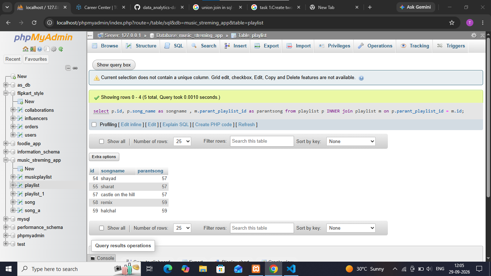

## task 2:Using a SELF JOIN, write a query on a table called Playlists (id, user_id, playlist_name, parent_playlist_id) to display each playlist alongside its parent playlist name, similar to how Spotify shows nested playlists.<br><br><em><strong>Hint:</strong> Join Playlists with itself on parent_playlist_id = id.</em>


```sql
select p.id, p.song_name as songname , m.parant_playlist_id as parantsong from playlist p 
INNER join playlist m on p.parant_playlist_id = m.id
```


