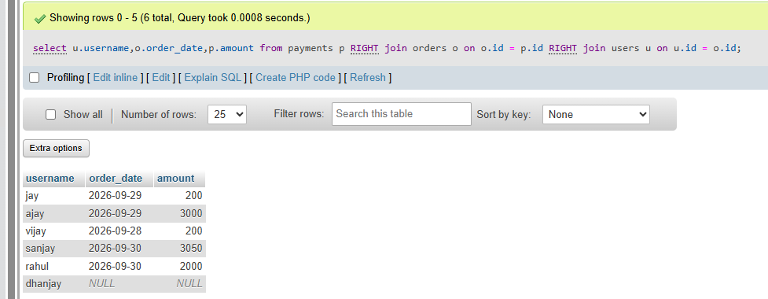

## task 3:Given three tables: Users (id, username), Orders (id, user_id, order_date), and Payments (id, order_id, amount), write a SQL query using multiple JOINs to display each username, their order date, and payment amount, showing all users even if they have no orders or payments.

```sql
CREATE table users
(
  id int PRIMARY key AUTO_INCREMENT,
  username varchar(255)
);

CREATE table orders
(
  id int PRIMARY key AUTO_INCREMENT ,
  user_id int ,
  order_date CURRENT_DATE ,
  FOREIGN KEY (user_id) REFERENCES users(id)
);
CREATE table payments
(
  id int PRIMARY key AUTO_INCREMENT ,
  order_id  int ,
  amount int ,
  FOREIGN KEY (order_id) REFERENCES orders(id)
)
```
```sql
select u.username,o.order_date,p.amount from payments p 
RIGHT join orders o on o.id = p.id 
RIGHT join users u  on u.id = o.id
```

