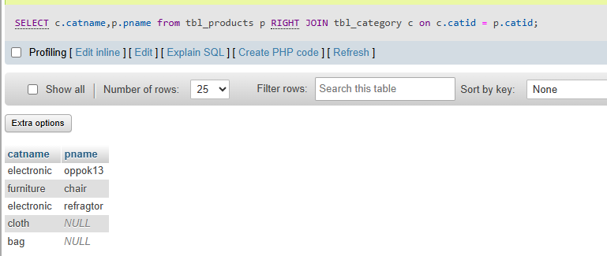
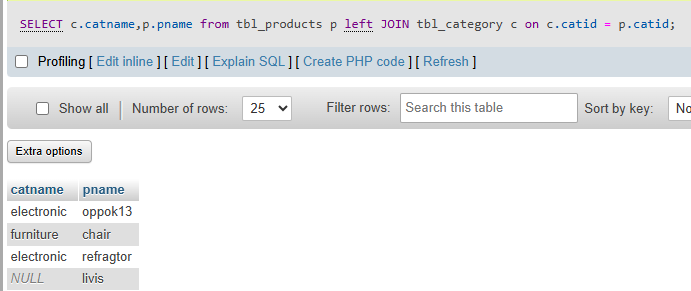
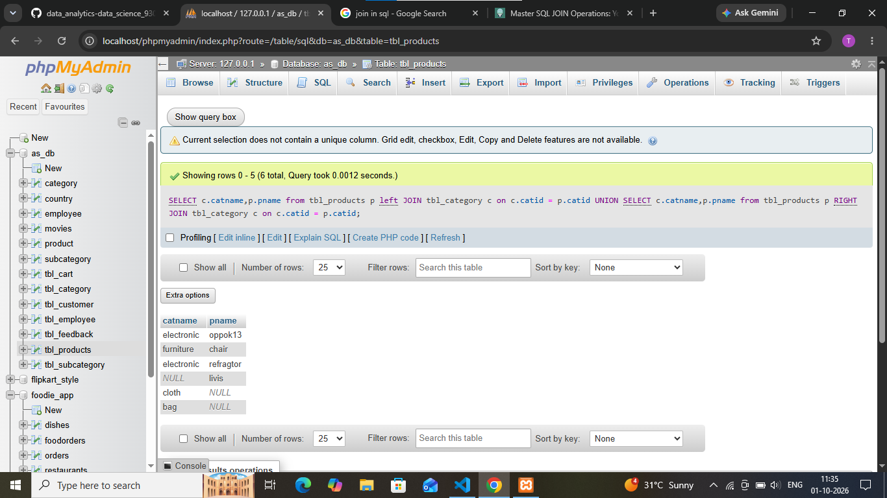

## task 5:Write two different JOIN queries on a Products and Categories table (like Flipkart) to list all products with their category names, but use different join conditions in each. Briefly explain which join condition is more efficient and why.


``` sql
SELECT c.catname,p.pname from tbl_products p 
RIGHT JOIN tbl_category c on c.catid = p.catid ;
```


``` sql
SELECT c.catname,p.pname from tbl_products p 
left JOIN tbl_category c on c.catid = p.catid ;
```



```sql
SELECT c.catname,p.pname from tbl_products p 
left JOIN tbl_category c on c.catid = p.catid 
UNION
SELECT c.catname,p.pname from tbl_products p 
RIGHT JOIN tbl_category c on c.catid = p.catid 
```




**Explation**

