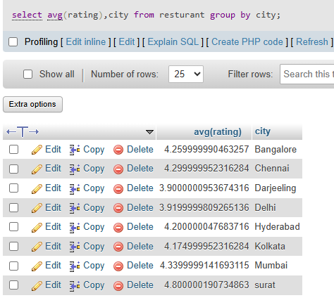
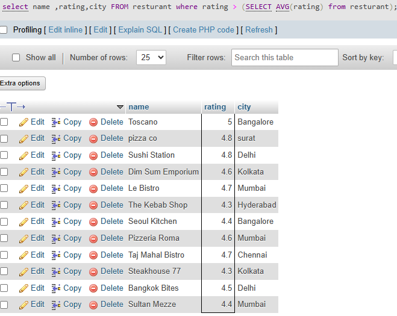

## task 1:Create a SQL query using a subquery in the WHERE clause to find all restaurants from a 'Restaurants' table whose average rating is higher than the average rating of all restaurants in the city.

**average rating of resturant in city**




```sql
select name ,rating,city FROM resturant where rating > (SELECT AVG(rating) from resturant) 
```


