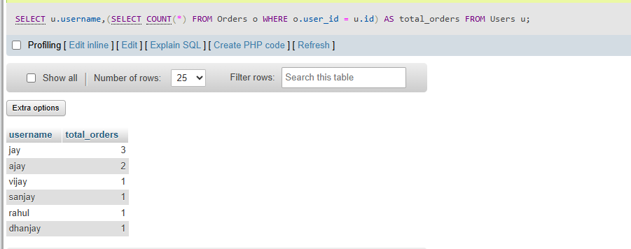

## task 2:Write a SQL query that uses a subquery in the SELECT statement to display each user's name from a 'Users' table along with the total number of orders they have placed from an 'Orders' table, like a summary you might see in a Zomato user profile.

```sql
SELECT u.username,
(SELECT COUNT(*) FROM Orders o  WHERE o.user_id = u.id) 
as total_orders FROM Users u;
```
