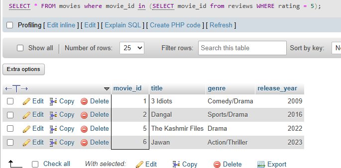

## task 3:Given a 'Movies' table and a 'Reviews' table, write a SQL query using IN with a subquery to list all movies that have at least one review with a rating of 5 stars, as seen in BookMyShow's top-rated section.

```sql
SELECT * FROM movies where movie_id in (SELECT movie_id  from reviews WHERE rating = 5)
```

