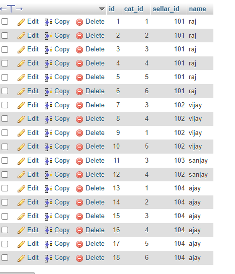
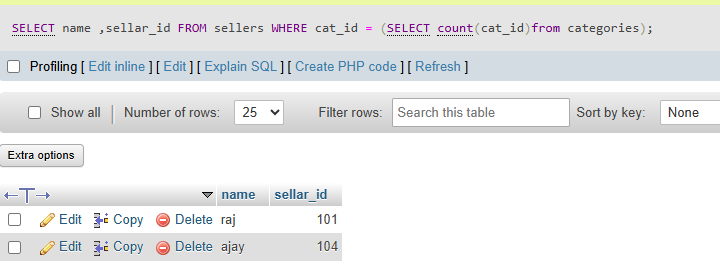

## task 4:Write a nested SQL query to find the names of all sellers from a 'Sellers' table on a Flipkart-style platform who have sold products in every category listed in a 'Categories' table.<br><br><em><strong>Hint:</strong> Use nested subqueries to compare seller's categories with the complete list of categories.</em>

# sellers catagory data



```sql
SELECT name ,sellar_id FROM sellers WHERE cat_id = (SELECT count(cat_id)from categories)
```




``` raj and ajay sell in all catgories```