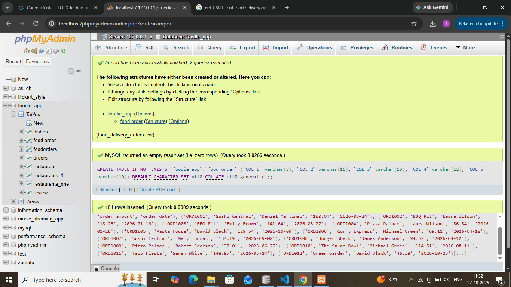
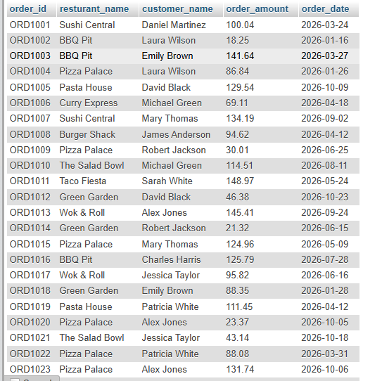

## Tasks 1:Import a CSV file of food delivery orders (with columns like order_id, restaurant_name, customer_name, order_amount, order_date) into a new SQL table named FoodOrders using your database tool of choice.

# import file name 
foo_delivery_order.csv

# import data in sql succesfully

# data import in mysql

