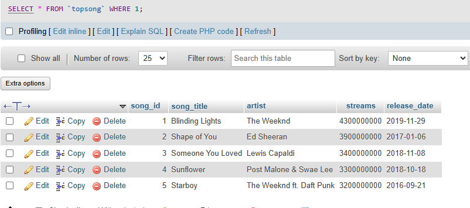

## Tasks 2:Write SQL statements to create a table called TopSongs with columns: song_id, song_title, artist, streams, and release_date, then insert at least 5 records representing popular tracks from Spotify.


```sql
create table TopSong(
 song_id int PRIMARY key AUTO_INCREMENT,
 song_title varchar(255),
 artist varchar(255),
 streams varchar(200), 
 release_date DATE
);

INSERT INTO TopSongs VALUES
(1, 'Blinding Lights', 'The Weeknd', 4300000000, '2019-11-29'),
(2, 'Shape of You', 'Ed Sheeran', 3900000000, '2017-01-06'),
(3, 'Someone You Loved', 'Lewis Capaldi', 3400000000, '2018-11-08'),
(4, 'Sunflower', 'Post Malone & Swae Lee', 3300000000, '2018-10-18'),
(5, 'Starboy', 'The Weeknd ft. Daft Punk', 3200000000, '2016-09-21');
```

