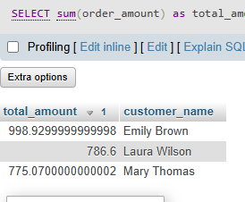

## Tasks 3:Write an SQL query to find the top 3 customers who ordered the most from the FoodOrders table based on total order_amount, and display their names and total spent.


```sql
SELECT 
sum(order_amount) as total_amount,customer_name
FROM
 food_order
GROUP by
customer_name 
order by 
total_amount DESC limit 3
```

