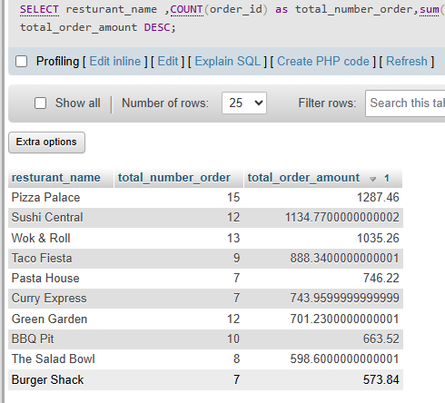

## Tasks 4:Generate a product performance report by writing an SQL query that lists each restaurant_name from FoodOrders, the number of orders, and the total order_amount, ordered by total order_amount descending.<br><br><em><strong>Hint:</strong> Use GROUP BY and ORDER BY clauses.</em>

```sql
SELECT 
resturant_name ,COUNT(order_id) as total_number_order,sum(order_amount)as total_order_amount
FROM
 food_order GROUP by resturant_name order by total_order_amount DESC
```

