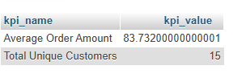

## Tasks 5:Create an SQL query that calculates two KPIs for the FoodOrders table: (1) average order_amount and (2) total number of unique customers, and format the output for dashboard display (two columns: kpi_name, kpi_value).

```sql
SELECT 
    'Average Order Amount' AS kpi_name,
    AVG(order_amount) AS kpi_value
FROM Food_Order

UNION ALL

SELECT 
    'Total Unique Customers' AS kpi_name,
    COUNT(DISTINCT customer_name) AS kpi_value
FROM food_order;

```

