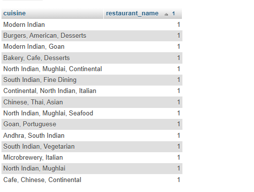

## Tasks 2:Write a SQL query to generate a report showing the number of restaurants for each cuisine type from your Restaurant table, ordered by the count in descending order.<br><br><em><strong>Hint:</strong> Use GROUP BY and ORDER BY.</em>

```sql
SELECT cuisine ,COUNT(*) as restaurant_name FROM restaurant
group by cuisine 
order by restaurant_name
```


