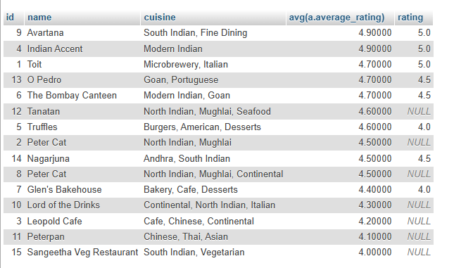

## Tasks 4:Write a SQL query using a JOIN to display each restaurant's name, cuisine, and its average review rating (from the Review table), ordered by highest average rating first.<br><br><em><strong>Hint:</strong> Use JOIN and GROUP BY with aggregate functions.</em>

```sql
select  a.id , a.name ,a.cuisine ,avg(a.average_rating) ,r.rating FROM review r
RIGHT JOIN restaurant a on r.restaurant_id=a.id
group by a.name ,a.id , a.cuisine
ORDER BY `a`.`average_rating` DESC
```

