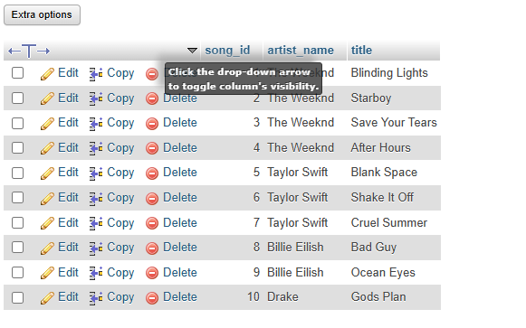
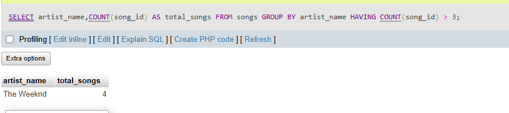

## Tasks 1:Write an SQL query to display the total number of songs uploaded by each artist from a table 'songs' (columns: song_id, artist_name, title) and show only those artists who have uploaded more than 3 songs.

# songs table 



```sql
SELECT artist_name,COUNT(song_id) AS total_songs FROM songs
GROUP BY artist_name
HAVING COUNT(song_id) > 3;
```

