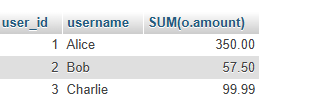

## Tasks 2:Given two tables, 'orders' (order_id, user_id, amount) and 'users' (user_id, username), write a SQL JOIN query to display each username along with their total order amount.

```sql
SELECT u.*,SUM(o.amount) FROM orders o CROSS join users u 
on u.user_id=o.user_id GROUP by user_id
```

