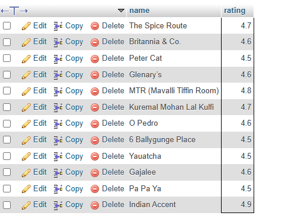

## Tasks 3:Write a SQL subquery to find the names of all restaurants from a 'restaurants' table (id, name, rating) whose rating is higher than the average rating of all restaurants.

```sql
select name ,rating FROM resturant where rating > (SELECT AVG(rating) from resturant) 
```


