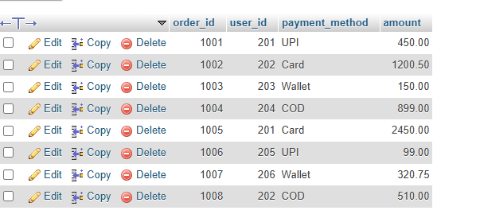

## task 1:Create a table called Orders with columns: order_id, user_id, payment_method, and amount. Insert at least 8 sample records representing different users and payment methods (like UPI, Card, Wallet, COD).

```sql 
CREATE table orders(
    order_id int PRIMARY KEY ,
    user_id int, 
    payment_method varchar(50) ,
    amount decimal(10,2)
);
INSERT INTO orders (order_id, user_id, payment_method, amount) VALUES
(1001, 201, 'UPI', 450.00 ),
(1002, 202, 'Card', 1200.50),
(1003, 203, 'Wallet', 150.00),
(1004, 204, 'COD', 899.00),
(1005, 201, 'Card', 2450.00),
(1006, 205, 'UPI', 99.00),
(1007, 206, 'Wallet', 320.75),
(1008, 202, 'COD', 510.00);
```

'

'