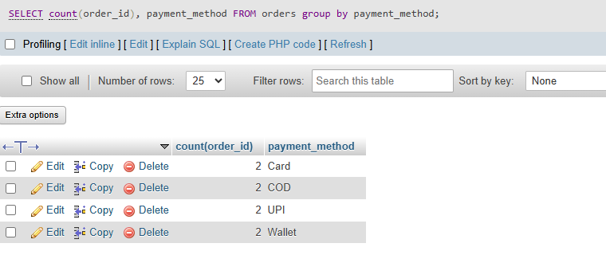

## task 2:Write an SQL query to count how many orders were placed using each payment_method in the Orders table, similar to how Zomato shows payment breakdown in analytics.

```sql
SELECT count(order_id), payment_method FROM orders group by payment_method ;
```
'

'