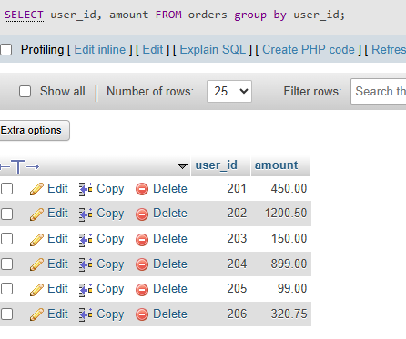

## task 3:Write an SQL query to find the total amount spent by each user_id in the Orders table. Display user_id and their total spend.

```sql
SELECT user_id, amount FROM orders group by user_id ;
```
'

'