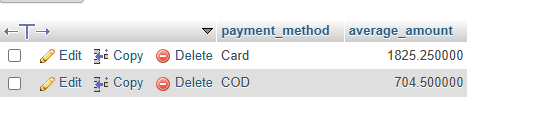

## task 4:Write an SQL query to show only those payment methods where the average order amount is greater than 300, using GROUP BY and HAVING.<br><br><em><strong>Hint:</strong> Use AVG(amount) in your HAVING clause.</em>


```sql
SELECT payment_method,avg(amount) as average_amount FROM orders GROUP by payment_method HAVING average_amount>300;
```
'

'
