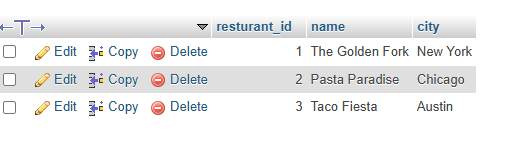
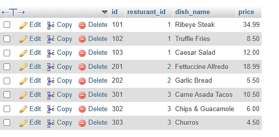

## task 1:Create two tables in your database: 'restaurants' (id, name, city) and 'dishes' (id, restaurant_id, dish_name, price). Insert at least 3 restaurants and 2-3 dishes for each restaurant.

create first table
```sql
-- resturants table
create table restaurants 
(
    resturant_id int AUTO_INCREMENT PRIMARY KEY ,
    name varchar(255),
    city varchar(200)
);
-- dish table 
create table dishes(
 id int PRIMARY KEY ,
  resturant_id int ,
  dish_name varchar(255),
  price decimal(10,2) ,
  FOREIGN key (resturant_id) REFERENCES restaurants(resturant_id) 
);
INSERT INTO restaurants(resturant_id, name, city) VALUES
(1, 'The Golden Fork', 'New York'),
(2, 'Pasta Paradise', 'Chicago'),
(3, 'Taco Fiesta', 'Austin');

-- Insert sample dishes (2-3 per restaurant)
INSERT INTO dishes VALUES
-- Dishes for The Golden Fork (ID: 1)
(101, 1, 'Ribeye Steak', 34.99),
(102, 1, 'Truffle Fries', 8.50),
(103, 1, 'Caesar Salad', 12.00),

-- Dishes for Pasta Paradise (ID: 2)
(201, 2, 'Fettuccine Alfredo', 18.99),
(202, 2, 'Garlic Bread', 5.50),

-- Dishes for Taco Fiesta (ID: 3)
(301, 3, 'Carne Asada Tacos', 10.50),
(302, 3, 'Chips & Guacamole', 6.00),
(303, 3, 'Churros', 4.50);
```

## **Restaurants table**
  
 

## **Dishes table**

