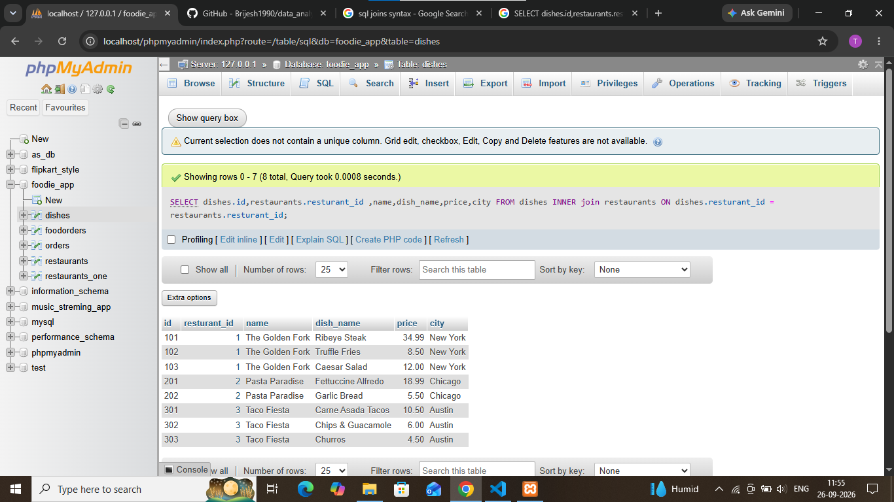

## task 2:Write an SQL INNER JOIN query to display each dish along with its restaurant name and city, similar to how Zomato shows dish details with the restaurant info.


```sql
SELECT dishes.id,restaurants.resturant_id ,name,dish_name,price,city  FROM dishes 
INNER join restaurants on dishes.resturant_id = restaurants.resturant_id ;
```

