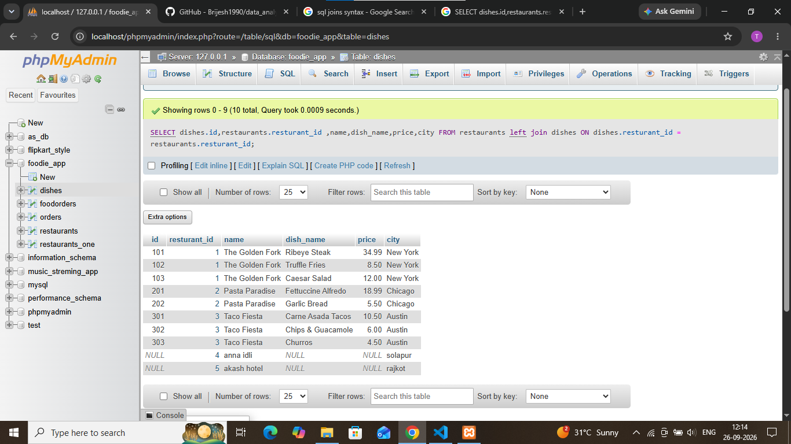

## task 3:Write an SQL LEFT JOIN query to list all restaurants and their dishes, showing restaurants even if they currently have no dishes on the menu.<br><br><em><strong>Hint:</strong> Use LEFT JOIN so restaurants without dishes still appear in the results with NULL for dish columns.</em>

``` sql
SELECT dishes.id,restaurants.resturant_id ,name,dish_name,price,city  FROM restaurants 
left join dishes ON dishes.resturant_id = restaurants.resturant_id ;
```


