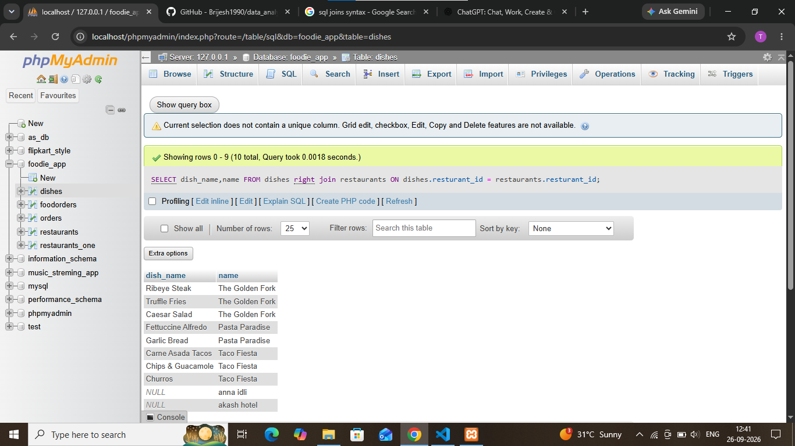

## task 4:Write an SQL RIGHT JOIN query to display all dishes and their restaurant names, including any dishes that might not be linked to a restaurant (simulate a data error where a dish has a restaurant_id that doesn't match any restaurant).

```sql
SELECT dish_name,name FROM dishes 
right join restaurants ON dishes.resturant_id = restaurants.resturant_id 
```

